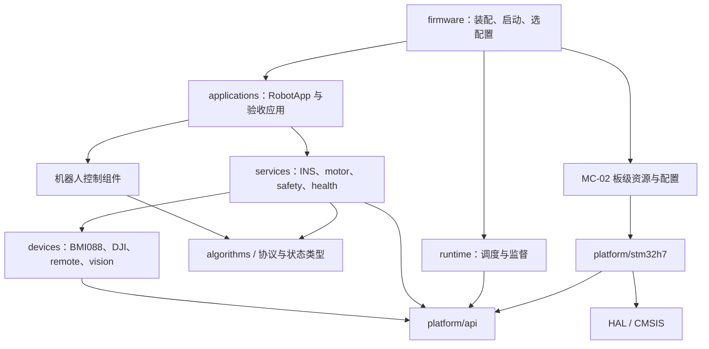
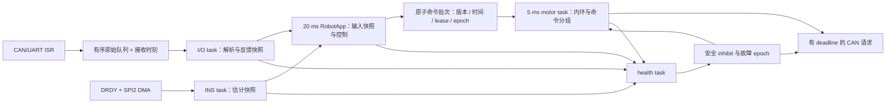

# RM2026 → MC-02 H7 移植方案

本文件保存架构与完整移植目标，不作为最新进度报告；当前完成情况见 [验收状态](../validation/README.md)。

状态：方案基线，2026-10-07。实现目录为 `/home/myself/workspace/RM/RM2027/dm-mc02`。本文件保留完整移植目标；早期实现推进到 P2/P3/P4 的组件及诊断阶段，见 [历史组件进度](../archive/milestones/2026-10-07_components.md)。验收条件不能仅凭编译通过判定完成。

2026-10-08 边界问题的源码修复和剩余验收见 [审计修复记录](../archive/milestones/2026-10-08_audit_fixes.md)。

## 1. 结论与首版范围

移植可行，值得继续沿用 RM2026 的组织方式。MC-02 保留了 BMI088 和常用通信接口，算法、协议及机器人组件有较高复用价值。工作量主要集中在 H7 的存储/DMA、FDCAN、板级资源和原有模块的平台耦合。

采用 **RM2026 应用/组件体系 + 新的 STM32H7 平台实现 + MC-02 板级资源配置**。参考 demo 提供引脚、外设组合和异步采集经验；原框架继续决定应用状态、任务边界和控制流程。

首版交付定义：

- 独立构建的 MC-02 FreeRTOS 固件及基础外设验收目标。
- 静态任务、无运行期堆分配；INS 1 ms、电机闭环 5 ms、RobotApp 20 ms 的行为对照版本。
- BMI088/INS、DJI 电机、所选遥控器、安全/健康监督、诊断；视觉与裁判系统通过独立串口可选启用。
- 明确缓存/DMA规则、错误统计、初始化失败路径、输出抑制和复位原因。
- 应用和公共组件不包含 STM32 HAL header，不直接使用 `hcan/huart/htim`。

达妙电机、CAN FD/BRS、轮腿示例、USB CDC、LCD/摄像头、外置 Flash 持久化及更快闭环按后续功能加入；换成 MC-02 并不要求原 DJI 执行器换成达妙电机。

## 2. 复用与重构边界

“复用”指保留算法或行为并对接口作必要调整，不代表原文件可以完全不改。

| RM2026 对象 | 决策 | 主要改动 |
| --- | --- | --- |
| `components/algorithms` | 高比例复用 | PID 接收明确 `dt`，去除内部 DWT 依赖；DSP 重新匹配 H7 |
| 视觉、遥控、裁判等纯协议与状态机 | 复用 | 将字节流输入、时间和 transport 与 parser 分离 |
| 安全状态机、健康检查思想 | 复用并完善 | 停止输出不依赖下一次 20 ms 应用循环；监督实际任务进度 |
| 底盘/云台/发射组件与 `RobotApp` | 保留行为 | 输入只读快照、输出命令批次；HAL binding 从 robot config 移出 |
| DJI 编解码、PID 和分组逻辑 | 复用并拆分 | CAN port 注入；保留电流/电压模式和 ID；反馈与执行状态分开 |
| BMI088 寄存器流程和原 EKF | 复用算法与校准流程 | SPI2 transport、轴变换、采样时间、错误/新鲜度信息；温控另行适配 |
| `platform/common/transport/rm_rx_queue` | 借鉴固定存储队列 | 按流数据/顺序反馈/最新命令选择不同语义；加入接收时间戳 |
| 正式 FreeRTOS runtime | 复用静态任务组织 | 调度入口与板型分离；新增有界 I/O task；测量接口经平台封装 |
| `platform/stm32f4` | 作为行为参考 | H7 的 CAN/UART/SPI/time/cache/watchdog 重新实现 |
| F407 generated/startup/linker/IRQ | 不移入 H7 正式目标 | 使用 H723 对应来源建立唯一板级入口 |
| 旧测试/demo/历史兼容模块 | 按需求迁移 | 不为首版把全部历史目标和传递依赖加入新构建 |

以 RM2026 的 `4cb0020` 为对照基线，原工程保持可追溯。新工程复制必需组件并记录来源，不从 `../../RM2026` 编译源文件，避免两工程互相影响或克隆后缺少路径。

## 3. 工程组织与依赖

### 建议目录

```text
dm-mc02/
├── CMakeLists.txt / CMakePresets.json
├── cmake/                         # 工具链、统一 flags、目标组合
├── platform/
│   ├── api/                       # 公共 port 契约，仅标准 C 类型
│   ├── common/                    # 固定队列、平台无关传输辅助
│   ├── stm32h7/                   # H7 HAL 适配、DMA/cache、时间等
│   └── boards/dm_mc02/
│       ├── generated/             # CubeMX 外设配置，边界清晰
│       ├── include/               # board 私有头，不向组件导出
│       ├── startup/ / linker/
│       ├── irq/ / fault/ / openocd/
│       └── dm_mc02.ioc             # 最终需与生效源码同步；目前仅保留 reference 下原始配置
├── runtime/
│   ├── freertos/                  # 静态任务与监督
│   └── baremetal/                 # 选用时复用相同服务 tick
├── components/
│   ├── algorithms/
│   ├── devices/                   # BMI088、DJI、remote、vision...
│   └── services/                  # INS、motor、health、safety、logging
├── applications/
│   ├── robot/                     # 应用控制与组件组合
│   └── board_bringup/             # 基础外设验收应用
├── config/
│   ├── boards/dm_mc02/            # 逻辑接口到硬件资源的映射
│   ├── robots/                    # 接线、ID、零位、几何、PID
│   └── profiles/                  # 功能、周期、超时、安全策略
├── firmware/dm_mc02/              # main、装配和固件目标入口
├── third_party/                   # HAL、CMSIS、FreeRTOS、可选 RTT
├── tests/host/ / tests/firmware/   # 后续实施并经要求开展的验证
└── docs/                          # 方案、接口、基线和来源记录
```

名称保持与原项目接近，但把 runtime 从固定 F407 路径移出。设备驱动、算法和服务按职责区分，例如 BMI088 是传感器设备，INS 是姿态估计服务。只迁移当前使用的实现，避免两套 BMI088 或多个 motor backend 同时成为隐式默认依赖。

### 依赖方向



平台 API 不依赖 devices/services/applications。装配层选择具体实现并绑定 port；设备和服务通过传入的小型函数表或 opaque handle 使用 port。无需每个类都增加复杂继承或动态注册系统。

CMake 使用显式 sources、目标级 include/defines/options，接口只暴露必要 `PUBLIC` 依赖。主机目标独立选择 toolchain，纯算法/协议/状态机可以不引入 HAL 和 FreeRTOS。避免通过全局 include 或巨型链接 group 掩盖循环依赖。

每个固件目标明确其 main、runtime、board、robot profile 和功能。构建启动输出记录这些选择以及 HAL/kernel/toolchain 版本。预计目标如 `app.elf`、`board_bringup.elf`、`imu_bringup.elf`、`can_bringup.elf`，实施时再固定命名。

## 4. 配置拆分

| 类别 | 内容 | 所有者 |
| --- | --- | --- |
| 板级资源 | 时钟、引脚、DMA、NVIC、MPU、内存；逻辑 serial/CAN/SPI ID 映射 | board / platform |
| 机器人接线 | 某个电机/设备绑定哪个逻辑 bus、ID、协议、方向、传感器安装变换 | robot profile |
| 机械与控制参数 | 减速比、零位、限位、几何、PID、弹速等 | robot profile |
| 运行策略 | 周期、lease、offline timeout、rearm、功能开关、日志后端 | runtime / feature profile |

移除 `robot_config.h` 中的 HAL handle 宏。应用看到 `BUS_CHASSIS`、`SERIAL_REMOTE` 这样的逻辑标识，具体映射只在装配时解决。

保留可追溯的 `legacy_rm2026` 参数配置用于行为对比，但实际接线与校准未确认时不作为默认运动配置。默认 bringup 不输出非零执行命令。正式运动 profile 采用明确重新解锁、必需电机健康检查和 INS 新鲜度检查；可选设备的掉线策略按功能区分，不把视觉失联无条件等同于整车停止。

生成配置要检查：重复 pin/DMA/串口占用、CAN ID/命令分组冲突、启用 backend 数量、正周期、超时大于周期、队列容量、消息 RAM 和静态内存范围。校验发生在编译/启动绑定阶段；运行期间不允许修改硬件映射。

参数调节在任务上下文进行，校验后原子提交一组参数及版本，不能让多个 PID 读到半更新的参数。外置 Flash 持久化另设事务/版本/CRC策略，首版使用编译期配置。

## 5. 平台与数据接口契约

以下名称为接口草案，实际实现应保持简洁。

### 统一时间和临界区

- `RmTime_NowUs()` 提供 64 位单调微秒，`NowMs32()` 用于已有 wrap-safe timeout。短时性能测量另提供 cycles/elapsed 接口。
- 算法显式接收 `dt_s`；设备/服务接收 `now` 或 clock port，不读取 DWT、HAL tick。
- `RmCritical_Enter/Exit` 按任务和 ISR 约束区分实现，保持嵌套恢复语义；短数据拷贝可以屏蔽相关中断，大块工作禁止在临界区执行。
- PRIMASK/BASEPRI 选择与 IRQ 优先级一起设计，不能将 F4 的实现机械改名后使用。

### UART

- RX：事件含 endpoint、有效字节和接收时间。HT/TC/IDLE 处理明确新数据区间，不能把 HAL 的 `Size` 每次都解释为全新数据长度。
- 连续流优先循环 DMA；ISR 将新字节复制到固定软件 ring，立即返回；I/O task 解析。DMA 正在写的存储不直接暴露给 parser。
- TX：`TrySendCopy()` 返回 accepted / busy / too-large / error；接受时复制到 transport 自有固定槽，调用者之后可复用输入缓冲。槽在完成/终止 callback 后才能重用。
- TX 接受、DMA 完成和协议对端收到是不同状态，统计分开。
- 溢出、UART error、DMA failure、restart failure 都有计数和事件。恢复由任务管理，不在 ISR 中等待 HAL 超时。

旧视觉发送流程先编码到常驻 `tx_frame`，再检查 UART busy，可能改写尚在 DMA 发送的缓冲；新版本统一依靠发送槽所有权解决，而不只补一处顺序检查。

### CAN

- 上层数据为 bus ID、identifier、standard/extended、payload、byte length、timestamp；classic/FD 能力属于 port 配置。
- HAL RX 暂存容量覆盖 HAL 可能复制的最大 payload；检查帧类型/DLC 后才复制到 classic 软件记录。TX 槽补零至固定 8 bytes，避免 HAL 按 word 读取时越过调用者短缓冲。
- 收取原始 feedback 到固定有序 ring，由 I/O task 解码；避免原 endpoint 单帧覆盖破坏编码器累计圈数或协议事务顺序。
- 原始反馈丢失时报告 gap/overflow；不能用迟到帧把已经失效的累计位置重新标为有效。按设备速度、最大采样间隔及重同步规则恢复。
- 发送电机命令以 bus+ID 保存最新尚未提交值和 deadline；固定数量的硬件请求可跟踪、完成或取消。日志和初始化控制帧按不同语义处理。
- bus-off/error callback 只记录状态、关闭输出许可并通知。任务根据协议状态、限次/退避策略重新建立总线；恢复后不自动重发旧运动命令。

### SPI / IMU / PWM

- SPI2 只允许一个事务拥有总线；片选、长度、buffer 和 timeout 在同一事务中登记。
- 完成/错误路径释放正确片选、结束 DMA 所有权，再发布采集结果；HAL_BUSY/ERROR 的启动失败同样释放资源。
- BMI088 驱动独立于 INS：初始化、读寄存器、解析 raw sample 经 sensor transport 完成。
- IMU sample 含 accel/gyro 各自 timestamp、sequence、valid/error；INS snapshot 另含估计时间、校准状态、新鲜度和数值健康状态。
- 内部统一使用 rad/rad·s⁻¹/m·s⁻²；原应用需要的 degree 等量在明确的兼容转换边界处理。传感器坐标到机器人本体坐标使用显式安装变换。
- heater/PWM 使用 0～1 duty 和频率接口，ARR/CCR 留在 board driver。

### 日志、故障和启动

- 高频路径发布固定长度日志/事件，不阻塞 UART，不长时间格式化。低优先级 drain 经 RTT 或 transport 自有 TX 槽输出，统计丢弃。
- Fault handler 记录寄存器、复位原因相关状态、任务标识和输出状态到指定 non-cacheable noinit 区；不依赖 `printf`、DMA 或动态内存。
- 初始化有固定最大等待/重试次数和全局 bootstrap deadline。失败保持禁止运动，输出可诊断的 failure stage。
- 任务先具备接收上下文和 endpoint 表，再启用相关 IRQ/DMA，避免 callback 访问半初始化模块。

## 6. 状态所有权与控制数据流

消除应用、设备 ISR 和诊断共同读写设备内部结构的情况。`g_robot` 可以暂时作为装配容器，设备内部可变状态不作为公共 API 暴露。

| 状态 | 唯一写入者 | 读/写方式 |
| --- | --- | --- |
| UART/CAN 原始队列 | 对应 transport ISR | I/O task 有界消费 |
| 电机反馈与累计编码器、遥控/视觉/裁判解析状态 | I/O task | 发布一致快照及 timestamp |
| BMI088 raw sample | sensor acquisition 路径 | INS task 消费稳定 sample |
| 姿态与标定状态 | INS task | snapshot copy |
| 应用模式、外环 PID、底盘/云台/发射组合状态 | control task | 快照输入，命令批次输出 |
| 电机内环 PID、发送分组、执行状态 | motor task | 只读反馈和应用命令，发布执行快照 |
| 紧急 inhibit / fault latch | safety service 的原子停机接口 | 任意有权上下文置停；只能由 control rearm 流程解除 |
| 任务监督、watchdog 决策 | health task | 读取运行统计与设备快照 |
| 日志排出 | diagnostics task | 固定队列读取，transport 管理 DMA |



control 一次提交完整的底盘、云台、发射目标及安全 epoch，motor 不消费半批命令。快照复制采用短临界区或适当固定双缓冲；不把 `volatile` 当成完整同步方案，也不在高优先级 task 中自旋等待被其抢占的 writer。

健康停机原子置 inhibit 并提升 epoch，motor 和 TX 提交时再次检查；旧批次、旧 lease 和旧 pending TX 不得因 rearm 重新有效。**许可检查、请求登记/硬件提交与停机撤销需要共享一个短同步边界**，避免检查许可后被停机抢占、返回后仍提交非零帧。高优先级紧急 ISR 的行为另行约束，不能只用 `volatile bool` 声称解决竞态。解除停机必须清理 PID、命令和需要重置的机构状态，然后接收新 epoch 的新命令。

## 7. RTOS 与采集组织

### 静态任务的初始安排

优先级数值越大，任务优先级越高。新增 I/O task 改善反馈/输入处理时延；原有算法执行周期先保持。

| 任务 | 周期 / 触发 | 初始优先级 | 职责 |
| --- | --- | --- | --- |
| INS | 1 ms 估计；采集事件可唤醒 | 5 | 有界采集服务、EKF、快照，不在 IRQ 执行 EKF |
| I/O | RX 事件 + 最迟 1 ms 周期服务 | 4 | CAN/UART 有序处理、设备解析、transport 恢复 |
| health | 5 ms + 严重故障事件 | 4 | 关键任务、设备、lease 监督和条件喂狗 |
| motor | 5 ms | 3 | 电机内环、分组发送和停止输出 |
| control | 20 ms | 2 | 原 RobotApp 行为和命令提交 |
| diagnostics | 10 ms 调度，内容按较低速率输出 | 1 | 日志、状态灯、快照遥测 |
| tuning | 可选，20 ms | 1 | 校验参数请求和生成遥测；关闭时不创建任务 |

tick 1 kHz，`xTaskCreateStatic` 等静态 API，禁止运行期 heap。旧栈大小仅作估算，H7 的调用链、FPU context 和日志实现改变后重新根据高水位确定。

I/O 每次唤醒都有帧数/字节数或时间预算，按 endpoint 公平处理，避免连续通信使低优先级 motor/control 无法运行。未处理完的数据保留并再次安排服务。记录 event-to-dispatch、queue depth 和最大运行时间；初始工程目标为反馈通常在 1 ms 内完成分发，最终以压力实测确认。

保留命令 lease 初始 100 ms、电机 feedback timeout 初始 20 ms作为旧版行为基线。任务 heartbeat、超期容差和连续超期次数继续保留，但标定/运行阶段分开管理；不能以普通 100 ms 启动宽限覆盖十余秒的 INS 标定。

### IMU 的渐进实现

1. P1/P3 初期用有超时的阻塞 SPI 验证 chip ID、初始化、静态数据和轴向，heater 关闭。
2. 正式采集改为 DRDY timestamp → SPI2 异步事务 → 稳定 raw sample → INS task 估计。
3. accel/gyro 在共享 SPI2 上串行事务；记录 pending、busy、timeout、missed DRDY，不采用 10 μs 定时器检查。
4. 首版姿态估计保持 1 kHz，分别记录 accel/gyro 的采样时刻；允许重复 accel 的条件和最大时间偏差由 INS 配置确定。融合 `dt` 来自样本时间，检查范围与数据新鲜度。
5. 原 gyro bias/EKF 保留；新版采集不直接替换为 demo 的另一套姿态算法。超过预算或数值失效进入明确故障状态。

裸机 runner 可作为早期 bringup；若保留正式裸机对照目标，它必须按同样 deadline 调用服务，不能把原 minimal 的主循环执行频率当作 1 ms INS 基线。

## 8. 传输与静态容量起点

容量是规划值，P2 根据波特率、最坏 burst 和 drain 延迟调整，不代表已经测得足够。

| 存储 | 初始容量 | 所在 RAM |
| --- | --- | --- |
| CAN 软件 raw ring | 每 bus 64 条 classic 记录；记录结构目标 32 bytes，三路约 6 KiB | AXI |
| UART DMA RX | remote 64 B、vision 512 B、referee 512 B、console 256 B | D2 non-cacheable |
| UART 软件 RX | remote 256 B、vision 2048 B、referee 2048 B、console 512 B | AXI |
| UART TX 槽 | vision 2×64 B、referee 2×256 B、console 2×256 B；按协议最大帧调整 | D2 non-cacheable |
| SPI2 原始收发槽 | 各 64 B，具体 dummy/寄存器长度由驱动约束 | D2 non-cacheable |
| SPI6/WS2812 | 按实际灯数编译期分配；常驻稳定发送槽 | D3 non-cacheable |

vision 在 921600 8N1 下满速约 92 KiB/s，512 B DMA 区仅约 5.6 ms，必须处理 HT/TC 和持续数据；不能依赖每 20 ms 解析一次或永久等待 IDLE。

CAN ring 用于保留反馈顺序，不能无限排队。满时记录丢失并使相关累计位置/协议事务失效；最新反馈时间采用 IRQ 收取时刻而不是 task 解析时刻，避免队列积压被误认为设备仍新鲜。

控制型 TX 只保留有界数量 pending 请求，不以扩大 CAN FIFO 来吸收控制阻塞。TX completion、abort、expired、bus-off 与 overflow 分别计数。发送 deadline 到期即丢弃；motor 不等待“邮箱空闲”直到破坏任务周期。

## 9. 需要在这次移植中落地的优化

| 既有问题 | 本次处理 | 完成标志 |
| --- | --- | --- |
| 公共模块包含 HAL，配置暴露硬件 handle | platform/api + 装配注入，四类配置拆分 | 应用/公共组件无 STM32 header，逻辑资源可重新绑定 |
| 目录分层但 CMake 仍存在大范围传递耦合 | 小目标、显式源文件、目标级依赖 | 纯算法/协议可以独立主机构建 |
| 全局结构、设备字段被跨任务访问 | owner + snapshot + command batch | 每种可变状态有唯一 writer，诊断只读 |
| PID/业务读取 DWT 或 HAL 时间 | 时间 port + 显式 dt | 同样输入/dt 不依赖 MCU 时钟得到同样算法行为 |
| DMA 缓冲交接/并发约束隐含 | transport 自有 DMA 槽、错误和完成状态 | busy 时不会改写正在传输的 frame |
| 安全动作等待 control 执行 | 原子 inhibit、epoch 和发送出口检查 | control 停止调度时仍撤销许可，旧命令无法恢复 |
| 日志可能占用控制周期 | 固定日志队列，低优先级排出 | 日志饱和仅增加 drop，不阻塞关键任务 |
| INS 只有 ready，缺少 fresh/numeric/error | 增加完整 sample/snapshot 状态 | 数据停滞、异常值、SPI error 可区分并阻止依赖它的运动 |
| 启动失败与长标定时序分散 | bootstrap 状态、总 deadline、watchdog 阶段策略 | 失败可定位，初始化不无限重试 |
| 多实现/历史兼容及文档与代码行为可能分叉 | 明确默认实现与配置，逐条记录行为 | 构建输出可识别实际 backend；文档与验收场景对应 |

原先讨论的具体控制行为或参数问题，例如软限位、单发触发边沿、机构调参，应在 P5 对照需求单独处理并记录行为变化；不与 H7 底层排障混在同一步骤中。平台层优化和所有权重构则从 P0/P1 起执行。

## 10. 实施阶段和验收出口

以下为阶段验收计划。当前已完成编译构建，尚未创建或运行测试、烧录或板上验证。每个阶段记录使用配置、构建版本、接线、观察数据和未完成项。

| 阶段 | 主要工作 | 交付物 | 出口条件 |
| --- | --- | --- | --- |
| P0 工程骨架与接口 | 选定配套 vendor 来源；CMake、board/API/config、来源清单；抽取纯协议/状态 | 独立工程骨架、依赖图、默认资源配置 | 无外部绝对源码路径；纯模块与 board 可分别构建；唯一 startup/IRQ/runtime |
| P1 H7 基础运行 | 时钟、启动、linker、MPU/cache、time、fault、安全 GPIO、RTOS 静态配置 | board bringup 固件、内存 map | reset/时钟/微秒计时正确；实际 DMA buffer 地址正确；D-Cache on 基线成立；无意外输出 |
| P2 通信与输入 | 三路 FDCAN、UART RX/TX、队列、I/O task、遥控和非阻塞日志 | CAN/UART/remote 验收目标及统计 | 三路 CAN 互不覆盖；格式/过滤/长度正确；连续 RX 无重复漏区；TX busy/overflow/error 行为可见 |
| P3 BMI088 / INS | SPI 基础、轴向、标定；再接 DRDY/DMA；原 EKF、fresh/finite、可选受限温控 | IMU/INS 验收目标和时序记录 | chip ID/静态重力/旋转符号正确；dt/采样频率合理；缓存开启稳定；断采样/错误导致 invalid |
| P4 电机服务 | 旧 DJI 编解码/协议绑定、反馈顺序/累计位置、5 ms 内环、TX deadline、lease、inhibit | 单电机与组包验收目标 | 实际型号/ID/量纲确认；零帧正确；feedback timeout、command timeout、TX busy 和 bus-off 能停止/隔离 |
| P5 RobotApp | 机器人 profile；底盘/云台/发射数据流；remote/safety；独立视觉/裁判串口 | MC-02 正式 app，兼容行为清单 | 原控制链逐项可用；rearm/掉线/PID reset 一致；真实零位/限位/轴向确认；文档和配置一致 |
| P6 稳定性与整理 | 压力、长时间、fault/recovery；任务预算、栈余量；按需功能扩展 | 上板记录、资源/内存/版本清单 | 没有无法解释的丢帧/卡死；overrun/overflow 都可观测；复位后不执行旧命令；发布配置可复现 |

实施从 P0/P1 开始，先建立能稳定启动、计时、诊断和按指定缓存策略收发 DMA 的板级基线，再接入业务。P2 与 P3 可以在 P1 出口之后分别推进，但整机迁移依赖两者都完成。

### 重点验收场景

- 主机侧：现有协议/安全状态机的适配回归；PID 显式 dt 的行为对比；lease/epoch、时间回绕、队列溢出和有效性转换。
- 通信侧：UART 分片/粘包、连续无 idle、HT/TC/IDLE 相邻事件、满缓冲、ORE/DMA 错误、TX busy；CAN 标准/扩展/远程帧、精确过滤、FIFO overflow、bus-off 和恢复。
- 缓存侧：正式 MPU/D-Cache 配置下持续 DMA 收发；地址边界检查；错误地传入 TCM 或非 DMA 槽时明确拒绝。
- 安全侧：冻结 control、INS、motor 或 I/O task；拔遥控/电机/IMU；旧 epoch 命令与已排队非零 TX；rearm 后只接受新命令。
- 时序侧：同时存在 CAN、遥控、视觉满速数据和日志时，记录任务最大运行时间、唤醒延迟、接收延迟与栈高水位。
- 生命周期：INS 标定失败/超时、warm reset、watchdog reset、HardFault 记录读取、TIM5 及毫秒 timeout 回绕。

验收阈值首先按旧任务周期和安全超时制定，实测后固定发布预算。不要凭 H7 算力假定周期一定满足，也不要为了移植阶段加速而同步修改 PID 和 EKF 频率。

## 11. 首版完成后的演进

1. 根据周期与延迟测量决定是否将内环提高到 1～2 ms，重新核对 CAN 利用率、PID dt 与反馈采样要求。
2. 将达妙电机加入同一反馈/命令/健康框架，区分 MIT、位置/速度模式、enable/disable 和 fault，不复用 DJI 的“零电流帧”停止语义。
3. 增加 USB/Flash/LCD 等独立可选功能；外置 Flash 写入不阻塞控制，参数读写带版本及恢复策略。
4. 提供第二板型时复用相同 platform/api、runtime 与组件，新增 board 和必要平台实现；不复制一套新的 RobotApp。

框架完成平台抽离后，其他 STM32 板型的工作可以主要集中在 board binding 与 transport 实现。迁往 Linux/ROS、其他 RTOS 或完全不同控制时序的平台，还需要新的 runtime 和实时约束评估，不能仅替换引脚表。

## 12. 相关文档

- [硬件基线](hardware_baseline.md)：内存、引脚、DMA、IRQ、FDCAN 布局与启动约束。
- [参考资料分析](../reference/reference_analysis.md)：实际阅读范围、源码取舍、资料矛盾与待确认项。
- [项目入口](../../README.md)：当前阶段和已确定方向。
