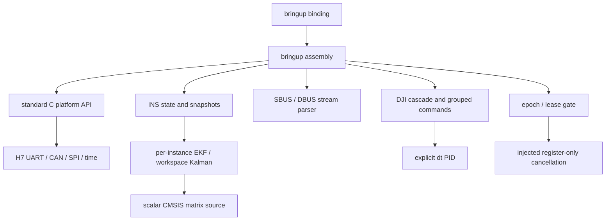

# 第二轮：INS / 遥控 / DJI 组件迁移

> 历史归档：本文件记录当时阶段，不代表当前进度。当前结论见 [验收状态](../../validation/README.md)。

日期：2026-10-07。承接 [第一轮板级基础](2026-10-07_platform.md)。本轮推进平台无关组件及 bringup 诊断接入，完整 RobotApp、异步 IMU 采集及硬件验收仍未完成。

2026-10-08 后续更新见 [审计修复](2026-10-08_audit_fixes.md)，资源和哈希以当前构建清单为准。

## 1. 已落地内容

| 对象 | 当前实现 | 运行接入 |
| --- | --- | --- |
| Kalman / QuaternionEKF | 原算法流程、实例独立工作区、不可变初始协方差、矩阵错误传播、数值检查 | INS task；host 可编译 |
| INS | 有界静止窗口、初始重力姿态、三轴零偏、轴映射、显式采样 dt、fresh/finite、重力补偿与运动加速度 | 1 ms task，当前仍用轮询 BMI088 数据 |
| remote | SBUS / DBUS 流式解析、重同步、有效帧续期、failsafe、边沿保留及消费 | I/O task 解析、control 消费边沿、health 检查新鲜度 |
| DJI | 型号/ID/分组校验、顺序反馈累计、位置连续性标志、原滤波、显式 dt 串级 PID、组帧、命令及反馈 deadline | 5 ms task；默认绑定零个电机；三路 CAN 另做被动候选监视 |
| 停止路径 | gate 失效或新 epoch 发出前立即取消旧 motion 请求；零 payload 通过独立受限 API 提交 | 平台和 service 已连接；实际总线停止验收待完成 |
| 配置 | `config/robots/bringup/binding.*` 集中 IMU 轴向/初始化参数、遥控映射、电机列表；串口格式跟随协议构建选项 | SBUS 默认；DBUS 独立 preset |

## 2. 依赖与所有权

组件不引入 HAL 头、句柄或 RTOS 类型。矩阵库选择官方综合例程中标记 V1.6.0 的六个 f32 源文件，使用独立最小类型头、矩阵维度检查及 scalar loop unroll；没有使用预编译 DSP ABI 或 NEON/MVE 分支。

- INS/EKF 由 ins task 单独修改；应用层复制 INS 快照。实例包含工作区内部指针，初始化后地址必须稳定，不能直接复制整个实例。
- 遥控 parser 由 I/O task 独占；I/O 提取边沿后原子发布快照并合并未消费边沿。control 使用 `RmBringup_TakeRemote` 消费发布邮箱，其他任务只读；失联或重同步后的首份有效数据不合成按下边沿。
- 电机反馈 staging 由 I/O task 修改；motor task 在短临界区复制反馈和命令，随后运行 PID。PID 计算期间不持有全局中断屏蔽。
- 被动 DJI 候选记录与正式 motor registry 分开。候选仅表示 CAN 数据符合该反馈布局，无法识别实际型号或证明该 ID 属于 DJI 电机。

## 3. INS 行为与旧版差异

bringup 配置：轴映射 `{1,2,3}`，连续 128 份静止样本；陀螺模长 < 0.1 rad/s，重力模长在 9.80665 ± 0.5 m/s² 内。默认轴向用于诊断，尚未确认整机安装方向。

初始化截止时间 5 s，包含 BMI088 初始化时间；runtime bootstrap 截止时间同步扩为 6 s。未保持静止时重新积累窗口但不延长总截止时间。结束为 RUNNING 或 FAILED，失败后保留诊断而不发布 valid 姿态。

融合间隔允许 0.25～10 ms，新鲜度 5 ms，重复 sequence 不重复积分；运行中的倒退时间、异常 dt 或非有限数据使实例失败。当前时间戳仍是 SPI 读取时刻，尚无 DRDY 样本时间/同步信息。

原 EKF 流程与噪声默认值继续沿用，以下改动单独记录：

1. 去掉全局 filter 和可变 static 中间量，callback 通过 workspace 的 instance context 找到自身。
2. 初始 covariance 固定；运行时 covariance 观测保存到实例诊断区，不再用于下一次初始化。
3. 去掉堆初始化入口，限定使用给定工作区，矩阵失败立即传递给 INS。
4. 旧反平方根的 `long` 宽度和指针别名假设改为 `sqrtf`；后验 quaternion 归一化，asin/acos 输入限幅。
5. 扩大 yaw 圈计数并检查边界；yaw 为相对航向，没有加入绝对航向传感器。Euler 的 Pitch/Roll 命名沿用原公式，整机绑定应核对各轴含义。
6. 新增静止窗口得到三轴初始零偏；未复用 C 板存储/历史零偏、比例或安装校准常数。

这批数值改动尚未做算法回归或实板姿态对照，不能据编译结果确认姿态精度。

## 4. 遥控行为

构建选择 `RM_REMOTE_PROTOCOL=SBUS` 或 `DBUS`，相应 UART5 分别为 100000 8E2 / 8E1，RX-only；parser 不在运行时重设 UART。

- SBUS 支持分片/多帧输入，检查 header、flags 保留位及常见 footer；ET08 通道/六档组合开关映射沿用旧 binding，归一化 span 为 660。
- DBUS 无帧头，通过通道、开关、鼠标按钮及 wheel 范围检查寻找 18-byte 对齐。两份结构有效帧用于锁定；没有 CRC，仍需实际原始帧确认对齐。
- 接收时间用于续期，不能以任务分发时刻给积压旧数据续命。有效帧 deadline 为 100 ms。
- SBUS frame_lost 不采纳该帧、不续期，上一份好数据只在剩余 deadline 内继续有效；failsafe 立即失效，恢复需重新锁定。
- 队列损失、UART 错误或恢复的 generation 改变立即撤销 snapshot、丢弃残帧；新好数据重新建立状态。
- 100 ms 内没有好帧时返回清零 offline 状态。键盘/鼠标/开关边沿累计至 `Take`，避免 20 ms control 漏过 I/O 收到的短边沿。

当前还未接入旧 ET08 机器人操作模式、rearm、视觉模式及底盘/云台/发射命令转换。

## 5. DJI 组件与停止语义

支持原 C610/M2006、C620/M3508 和 **GM6020 电压模式**；未推定新版 GM6020 电流协议可用。M2006/M3508 ID 为 1～8，GM6020 为 1～7。初始化检查同 bus 反馈 ID 和同组 payload slot 冲突。

反馈保持转子量纲：编码器、RPM、deg/s、rad/s、当前 wire 原始值和滤波值、温度；未自动除减速比。角度 PID 使用 degree，速度单位在 binding 中显式指定。参考、输出和反馈符号显式配置，去掉运动中自动推测角度符号的行为。

反馈断流/generation 改变、精确半圈或转速/接收间隔显示可能发生半圈混叠时，累计位置标记不可用；速度反馈可以独立恢复，位置闭环保持禁用。需要停止后的明确位置重建 `RmDji_RebasePosition`，不能自动猜测漏掉的圈数。该 API 的调用与 staging 同步需由正式应用所有者完成，当前 bringup 无重建命令入口。

每次控制根据 copied command 的外环依次通过 angle→speed→current，支持带时效的外部反馈和前馈；命令过期、反馈超时、gate/epoch 不符或数值异常均输出零并复位 PID。末端限幅沿用 10000 / 16384 / 30000 ESC wire units。

同 bus 同 ID 未提交的命令合并为最新值，已经在硬件中的请求保留自己的 epoch/deadline。组 deadline 取 gate、有效 command、feedback、外部反馈和本轮 transport 预算的最短者，防止借用别的电机或新命令的有效期。

`RmCan_SubmitZeroFrame` 仅接受标准 8-byte 全零 payload、最长 100 ms deadline。它绕过运动 gate，供明确绑定的 DJI command ID 发送零输出；不能把任意协议的全零 payload 当成停止命令。gate Stop/Arm 注入 `RmCan_CancelMotion`，取消旧 pending/in-flight motion，保留零 payload 请求。

bus-off 或发送失败时无法保证零帧到达；帧已经上总线后也无法撤回。正式应用仍需执行器自身超时和已确认供电策略，板上核对 deadline、取消、重启和零帧的实际表现。

默认 motor_count 为零，固件不向猜测 ID 发送零帧。I/O 监视三路 `0x201..0x20b` 标准反馈候选，诊断每秒报告 seen/online bit mask。

## 6. 构建与观察

`h7-debug`、`h7-release`、`h7-dbus-debug` 和 `host` 已编译通过；产生 firmware ELF/BIN/HEX/map、`librm_logic.a` 和 `librm_matrix.a`。本轮未添加或运行测试、烧录、硬件验证。

第二轮资源约 Flash 73 KB、AXI 37.5 KB；后续修复的精确大小与哈希见 [build_manifest.json](../records/build_manifest_2026-10-11.json)，map 为当前链接布局依据。

诊断新增 event 14～19，见 [构建指南](../../guides/build_and_bringup.md)。快照入口：

| API | 输出 |
| --- | --- |
| `RmBringup_ReadIns` | 校准/运行/失败状态、错误、quaternion、相对 Euler、SI 数据、时间及 valid |
| `RmBringup_ReadRemote` | 按时间和 transport generation 检查过的标准输入快照 |
| `RmBringup_TakeRemote` | 标准输入快照及一次消费的累计边沿，唯一 control 消费者使用 |
| `RmBringup_ReadDjiCandidate` | 所选 bus/ID 的被动反馈候选及新鲜度，不作为执行器绑定 |

## 7. 接续工作

1. 先确认本轮轮询原始 IMU、轴向、静止校准/EKF输出，以及真实 SBUS/DBUS 字节流；随后接 DRDY/DMA，避免缺少时间基线时同时改变全部采样机制。
2. 按确认的接线/型号建立正式 robot binding 和机械参数，电机服务增加正式命令发布、位置重建与健康接口；进入单电机、零输出及闭环验收。
3. 迁移 RobotApp/底盘/云台/发射与输入模式，接视觉回包及裁判服务；记录与旧版行为差异。
4. 完整同步 CubeMX 资源、验收 UART abort 隔离与 CAN 恢复策略，然后按 P6 固定队列、时序和栈预算。
